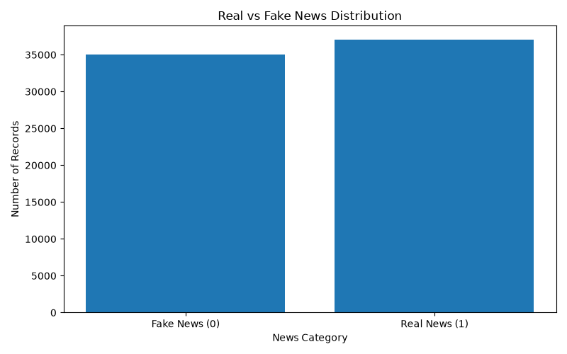
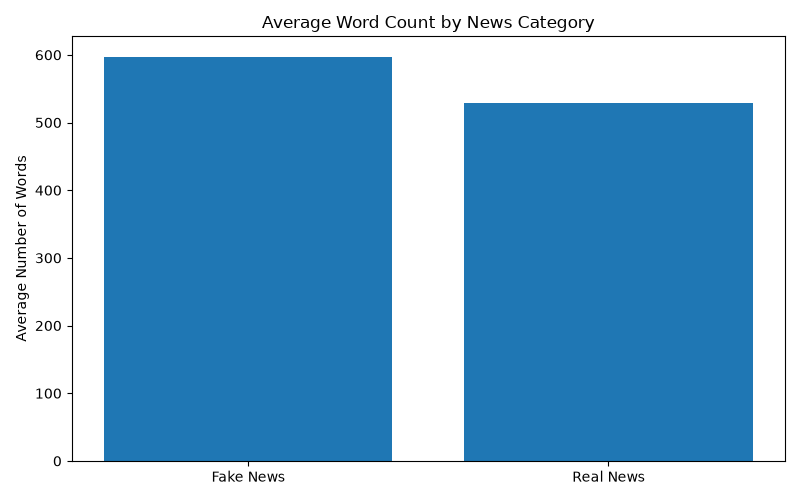
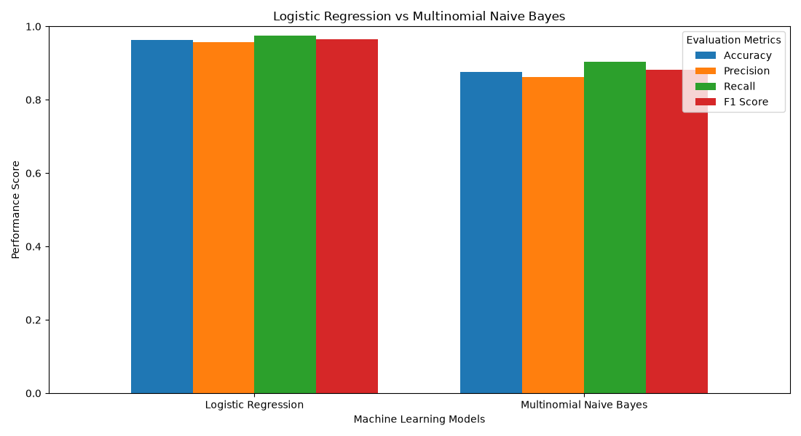

# Smart Fake News Detection System

A machine-learning-based news text classification project built with
**Python, Natural Language Processing (NLP), TF-IDF, scikit-learn, and
Streamlit**.

The application analyses text entered by a user and predicts whether it
resembles the **fake** or **real** class learned from the labelled
training dataset. It is an educational classification prototype, not an
independent fact-checking service.

## Project and Internship Information

  Detail                    Information
  ------------------------- ----------------------------------
  Project                   Smart Fake News Detection System
  Intern                    Shubham Aher
  Internship organization   InternsElite
  Internship duration       3 months
  Mentor                    Pratham Saxena
  Academic affiliation      Sanjivani University, Kopargaon

## Key Features

-   Inspect and preprocess a labelled news dataset.
-   Combine article titles and article text.
-   Clean text by lowercasing, removing HTML and URLs, filtering
    non-alphanumeric characters, and normalising whitespace.
-   Explore label distribution and text characteristics with
    visualisations.
-   Convert text into numerical features using TF-IDF with unigram and
    bigram features.
-   Train and compare Logistic Regression and Multinomial Naive Bayes.
-   Evaluate models using accuracy, precision, recall, F1-score, and
    confusion matrices.
-   Save trained models and the TF-IDF vectorizer using Joblib.
-   Run predictions through a Streamlit web interface.

## Technology Stack

-   **Language:** Python
-   **Data handling:** pandas, NumPy
-   **Machine learning / NLP:** scikit-learn, TF-IDF
-   **Model persistence:** Joblib
-   **Visualisation:** Matplotlib
-   **Web application:** Streamlit
-   **Development environment:** Visual Studio Code

## Dataset

This project uses the **WELFake dataset** downloaded from Kaggle:

[Fake News Classification / WELFake dataset on
Kaggle](https://www.kaggle.com/datasets/saurabhshahane/fake-news-classification)

The inspected source CSV contained 72,134 records with the columns
`Unnamed: 0`, `title`, `text`, and `label`. The title and article body
are combined for text classification. The index-like `Unnamed: 0` column
is not used as a model feature.

### Download and place the dataset

The raw and cleaned CSV files are intentionally excluded from this Git
repository because of their size. To run the complete pipeline:

1.  Download the dataset from the Kaggle link above.
2.  Create the `data` directory in the project root if it does not
    exist.
3.  Place the downloaded CSV at `data/fake_news_dataset.csv`.
4.  Run the preprocessing script as described below.

**Label mapping:** The application code currently interprets `0` as
**Fake** and `1` as **Real**. Verify this mapping against the dataset
documentation and keep it consistent if you modify the project.

## Project Structure

``` text
smart-fake-news-detection/
├── app/
│   └── streamlit_app.py
├── data/
│   └── (download dataset; CSV files are not committed)
├── models/
│   ├── logistic_regression.joblib
│   ├── model.joblib
│   ├── multinomial_naive_bayes.joblib
│   └── tfidf_vectorizer.joblib
├── outputs/
│   ├── evaluation_results/
│   │   └── model_comparison.csv
│   └── visualizations/
│       ├── average_word_count.png
│       ├── fake_news_top_words.png
│       ├── label_distribution.png
│       ├── logistic_regression_confusion_matrix.png
│       ├── model_comparison.png
│       ├── multinomial_naive_bayes_confusion_matrix.png
│       ├── real_news_top_words.png
│       └── text_length_distribution.png
├── screenshots/
├── src/
│   ├── eda.py
│   ├── feature_extraction.py
│   ├── model_comparison.py
│   ├── preprocessing.py
│   └── train_model.py
├── inspect_dataset.py
├── requirements.txt
├── requirements-lock.txt
├── test_setup.py
├── .gitignore
└── README.md
```

## Setup and Installation

### 1. Clone the repository

``` bash
git clone https://github.com/shubhamaher95/smart-fake-news-detection.git
cd smart-fake-news-detection
```

### 2. Create and activate a virtual environment

**Windows PowerShell:**

``` powershell
python -m venv venv
.\venv\Scripts\Activate.ps1
```

If PowerShell blocks activation, use Command Prompt:

``` cmd
venv\Scripts\activate.bat
```

### 3. Install dependencies

``` bash
python -m pip install --upgrade pip
python -m pip install -r requirements.txt
```

### 4. Download the dataset

Follow the Dataset section and place the CSV at
`data/fake_news_dataset.csv`.

## Run the Project

Run these commands from the repository root, with the virtual
environment activated:

``` bash
python inspect_dataset.py
python src/preprocessing.py
python src/eda.py
python src/feature_extraction.py
python src/train_model.py
python src/model_comparison.py
```

Start the Streamlit application:

``` bash
python -m streamlit run app/streamlit_app.py
```

Streamlit will display a local URL in the terminal, usually
`http://localhost:8501`.

> The repository includes trained model and vectorizer files. If you
> only want to launch the app and the required files are present, you
> may be able to run the Streamlit command directly without retraining.
> The full pipeline requires the dataset download.

## Model Development and Evaluation

Two classifiers are trained:

1.  **Logistic Regression** --- a linear classifier commonly used for
    sparse text features.
2.  **Multinomial Naive Bayes** --- a probabilistic classifier commonly
    used for text categorisation.

The text is represented using TF-IDF. The vectorizer is fitted on the
training data and then applied to the test data to avoid fitting
vocabulary statistics on the test split.

Evaluation uses accuracy, precision, recall, F1-score, and confusion
matrices.

### Results

Insert the verified values from
`outputs/evaluation_results/model_comparison.csv` here after confirming
that the CSV contains the final evaluation results. Do not report
unverified or estimated scores.

  -------------------------------------------------------------------------
  Model               Accuracy      Precision         Recall       F1-score
  ------------- -------------- -------------- -------------- --------------
  Logistic        To be filled   To be filled   To be filled   To be filled
  Regression                                                 

  Multinomial     To be filled   To be filled   To be filled   To be filled
  Naive Bayes                                                
  -------------------------------------------------------------------------

**Selected model:** Confirm the model saved as `models/model.joblib` and
update this line if necessary.

## Visualisations

### Live demonstration
https://smart-fake-news-detection.streamlit.app/

### Class distribution



### Text length distribution


### Average word count



### Model comparison



### Confusion matrices

  ---------------------------------------------------------------------------------------------------------------------------------------------------------
  Logistic Regression                                                        Multinomial Naive Bayes
  -------------------------------------------------------------------------- ------------------------------------------------------------------------------
     matrix](outputs/visualizations/multinomial_naive_bayes_confusion_matrix.png)

  ---------------------------------------------------------------------------------------------------------------------------------------------------------

## Important Limitations

-   The model learns patterns from the dataset; it does not
    independently verify facts or claims.
-   Dataset labels can be imperfect and may reflect source, topic,
    political, geographic, or time-period biases.
-   Performance on the test split does not guarantee performance on new
    or out-of-domain articles.
-   A prediction or probability score is not proof that a news article
    is true or false.
-   Important claims should be checked against primary sources and
    multiple reliable news organisations.

This project should be treated as an educational decision-support
prototype, not as the sole basis for judging the credibility of news.

## Future Improvements

-   Evaluate on newer and independently collected news articles.
-   Use cross-validation and systematic hyperparameter tuning.
-   Compare additional models, including transformer-based approaches.
-   Analyse performance across different topics and sources.
-   Add explainability and clearer uncertainty communication.
-   Integrate links to reputable fact-checking resources.

## Author

**Shubham Aher**\
Internship Organization: **InternsElite**\
Mentor: **Pratham Saxena**\
Duration: **3 months**\
Academic Affiliation: **Sanjivani University, Kopargaon**

## Acknowledgements

Thanks to **InternsElite** and mentor **Pratham Saxena** for the
internship opportunity and guidance during this project.

## License

No license has been specified for this repository yet. If you intend
others to reuse or modify this project, choose and add an appropriate
open-source license after confirming that you have the rights to license
all included code and assets.
